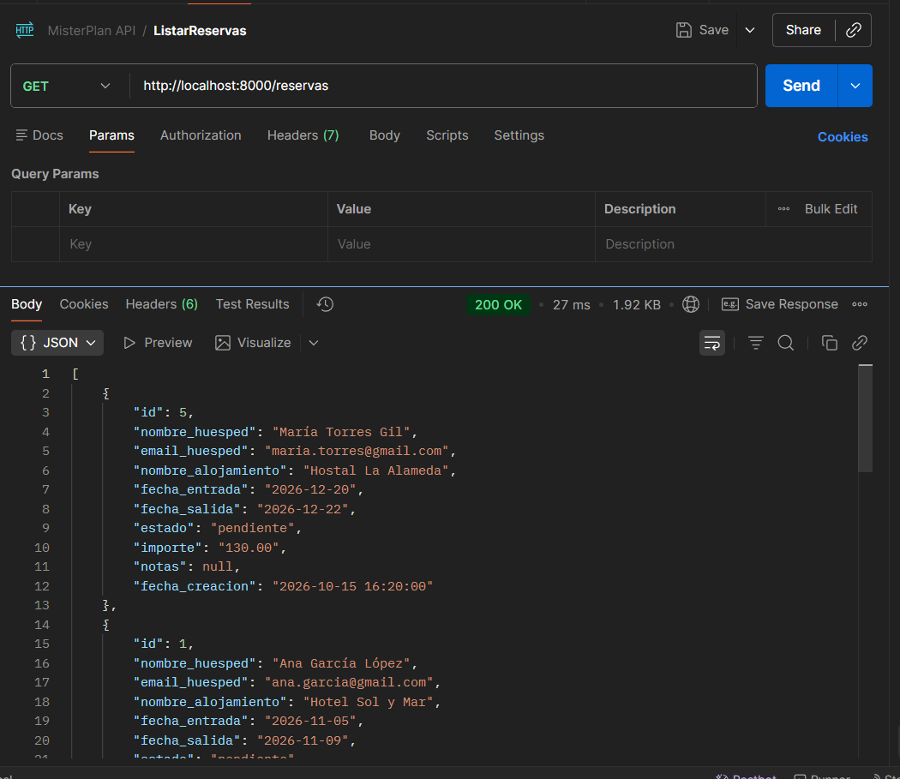
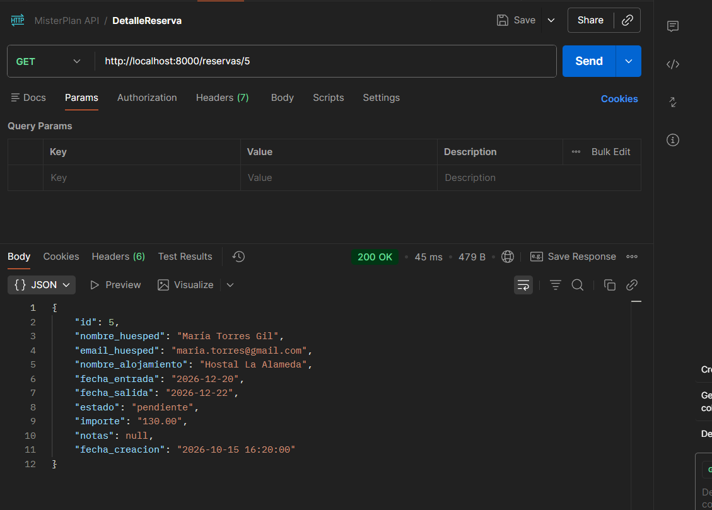
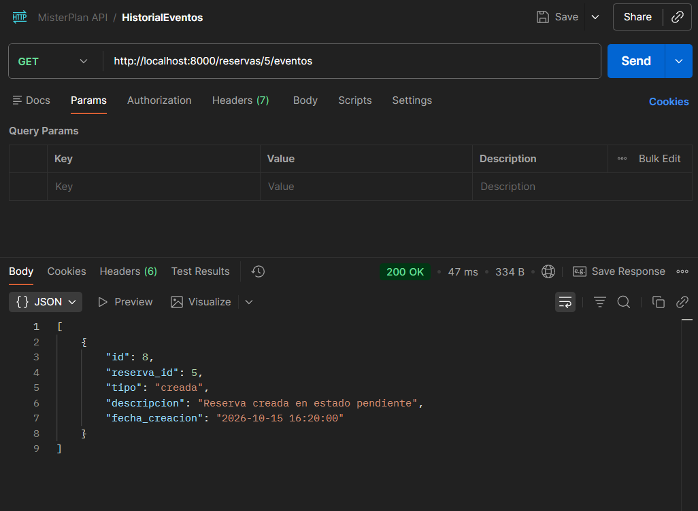
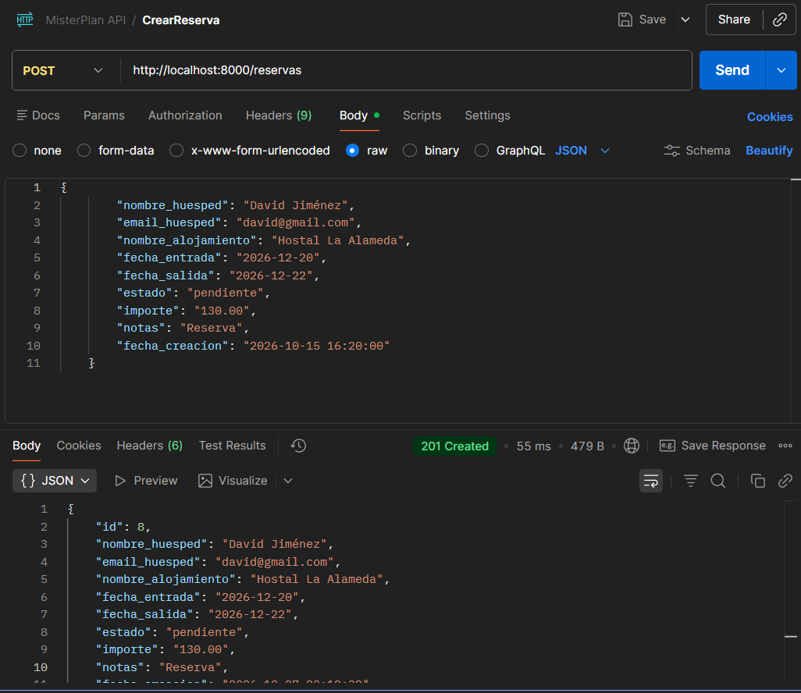
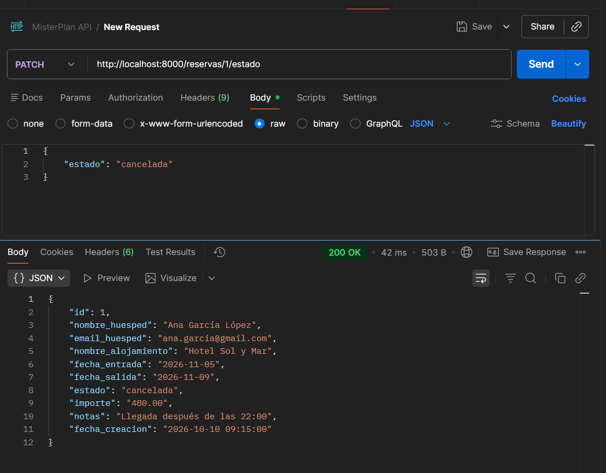

# Reservas de alojamiento

Aplicación de gestión de reservas  para la prueba técnica de MisterPlan. Incluye una API REST en PHP nativo , dos vistas renderizadas con Twig y una interfaz con JavaScript vanilla que consume la API.

**Demo desplegada:** https://gestor-reservas.infinityfree.io/

## Cómo ejecutar el proyecto en local

### Requisitos

- PHP 8.1 o superior 
- MySQL o MariaDB 
- Composer
- Un entorno local como XAMPP, MAMP o WAMP.

### Instalación

1. **Clonar el repositorio** :

   ```bash
   git clone https://github.com/martaalopez/GestorReservas.git
   ```

2. **Instalar las dependencias** (Twig):

   ```bash
   composer install
   ```
   
3. **Para ejecutar el proyecto en local se tiene que utlizar XAMPP. Apache y MySQL deben estar iniciados para disponer del servidor web y de la base de datos.**


4. **Importar el archivo SQL del proyecto desde phpMyAdmin, utilizando la pestaña Importar o la pestaña SQL.**

5. **Configurar las variables de entorno.**                                                                                            
   Configurar el archivo .env con los datos de conexión del entorno local.
   ```
   DB_HOST=127.0.0.1
   DB_PORT=3306
   DB_NAME=reservas
   DB_USER=NOMBRE_USUARIO
   DB_PASS=
   ```

6. **Arrancar el servidor** desde la raíz del proyecto

   ```bash
   php -S localhost:8000 -t htdocs
   ```

7. **Abrir** [http://localhost:8000/vistas/reservas](http://localhost:8000/vistas/reservas)


## Decisiones de diseño

**Capas separadas.** Cada clase tiene una función diferente:

- *Controller*: recibe las peticiones y devuelve las respuestas.
- *Service*: contiene las reglas y controla las operaciones.
- *Repository*:  se encarga de las consultas a la base de datos.
- *Validator*: comprueba que los datos sean correctos.


**Router.** Como la API solo tiene cinco rutas, se utiliza un sistema de rutas sencillo.

**MySQL.** Se utiliza una base de datos relacional para guardar la información.

**Transacciones.** Cuando se crea una reserva y su evento, ambas operaciones se realizan juntas.

**Gestión de errores.** Los errores se controlan desde un único archivo (index.php). Según el tipo de error, se devuelve un código como 422, 404 o 400. Si ocurre un error inesperado, se devuelve un 500.

## Tests

Para validar el correcto funcionamiento de la API antes de conectar el frontend, realicé varias pruebas manuales con Postman.

**Listar todas las reservas:**



**Ver detalle de una reserva concreta:**



**Ver el historial de eventos de una reserva:**



**Crear una reserva:**



**Cambiar estado de una reserva:**



## Qué mejoraría con más tiempo

- **Tests** con PHPUnit.
- **Acceso para clientes** añadir un sistema de inicio de sesión y una interfaz para que cada cliente pueda gestionar sus reservas.
- **Acceso para administradores**  permitir que cada administrador consulte y gestione las reservas de su hotel.
- **Mejoras en la interfaz**  : mejorar el diseño visual y añadir nuevas funcionalidades para facilitar el uso de la aplicación.

## Escalabilidad: 1000 reservas/hora

En caso de que el tráfico creciera más, primero comprobaría qué partes de la aplicación funcionan más lentas antes de hacer cambios .
Como primeras mejoras, añadiría paginación para no cargar todos los registros a la vez.

